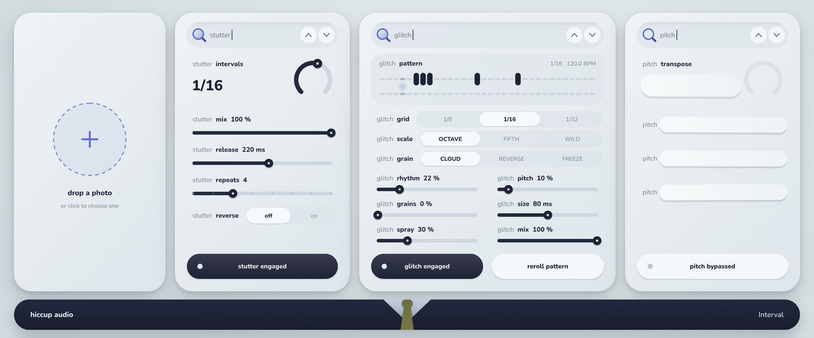

# Interval

by hiccup audio

An Audio Unit that plays with time and pitch intervals. Three modules, chained in this order: **stutter**, **glitch** and **pitch**.

## Get the plugin

### Download from GitHub Actions

Every push to `main` builds the plugin on a GitHub Mac and validates it with Apple's `auval`.

1. Open the **Actions** tab, then the latest **Build macOS** run
2. Under **Artifacts**, download **Interval-macOS** and unzip it until you see `Interval.component` and `Interval.app`
3. Move `Interval.component` to `~/Library/Audio/Plug-Ins/Components`
4. Downloaded plugins are blocked by macOS until you clear the quarantine flag, so run this in Terminal:

       xattr -dr com.apple.quarantine ~/Library/Audio/Plug-Ins/Components/Interval.component

5. Restart your DAW and look under hiccup audio > Interval

### Or build it on your Mac

    bash build_mac.sh

This uses Apple's Command Line Tools (it opens their installer if they are missing), fetches CMake and JUCE if needed,
compiles, installs to `~/Library/Audio/Plug-Ins/Components/Interval.component`, and runs `auval`.
`bash build_mac.sh universal` builds for both Apple silicon and Intel.

If an earlier `hiccup.component` is installed, the script removes it: Interval replaces it and keeps its AU codes,
so sessions saved with it still load.

## The modules

**stutter**
- `intervals`: how often a hit fires, 1/2 to 1/64 including triplets, locked to the host tempo
- `mix`: dry and stutter balance
- `release`: how long each hit rings, 5 ms to 2 s, the far end is no decay
- `repeats`: hits per cycle before fresh audio is captured, 2 to 16, or `hold` to freeze the first slice
- `reverse`: plays repeats backwards

**glitch**
- `rhythm`: rhythm glitch amount. Ratchets, reversals, jump-backs, tape stops, drops and gates
- `pitch`: pitch glitch amount. Jumps, slides and flutter, and it also detunes the grains
- `grains`: granular cloud amount and density
- `size`: grain length, 10 to 500 ms
- `spray`: how far back in time and how wide in stereo grains scatter
- `mix`: the whole module's wet and dry balance
- `grid`: step size 1/8, 1/16, 1/32
- `scale`: pitch intervals OCTAVE, FIFTH or WILD
- `grain`: CLOUD, REVERSE or FREEZE
- `reroll pattern`: draws a new 2-bar pattern. A pattern repeats exactly until you reroll, and it saves with your session
- The chart shows the live pattern: rhythm events on top, pitch events below, sparks for grains

**pitch**
- `transpose`: -24 to +24 semitones
- `harmony`: 16 intervals and chords (octaves, fifths, 3rds, major, minor, sus, 7ths, dim, aug). Follows `transpose`
- `blend`: harmony level
- `mix`: dry and wet balance

## Handling

- Drag a row left and right, or up and down. Hold shift for fine control, double-click to reset, scroll works too
- Engage buttons: click to latch, press and hold to use them as momentary (let go and it flips back)
- A bypassed module's values go under paper strips. Hover a row to lift its strip and adjust it anyway
- The magnifier's lens fills while a module is engaged, and the stutter lens pulses with every hit
- The search field shows what you just touched
- Chevrons on the outer cards step that module's presets, chevrons on the glitch card step whole-plugin scenes
- Drag the window corner to resize

## The portrait panel

The large panel on the left holds any picture you like. The plugin ships with none.

- Drop an image on it, or click the empty panel to choose one (PNG, JPEG or GIF)
- Drag the picture to reposition it, double-click to replace it, hover and use the round button to remove it
- Your copy is kept in `~/Library/Application Support/hiccup audio/Interval`, so every instance shows it and it stays on your machine: it is not saved into sessions or presets

## Latency

Pitch uses a spectral shifter, so the plugin reports a constant 90 ms (at 44.1 kHz) to the host, which compensates
automatically. The dry path is delayed to match, so nothing shifts in time when you toggle modules. It matters only if
you monitor a live input through the plugin while recording.

## Project layout

    .github/workflows    the macOS build and validation
    source/dsp           the audio engine
    source/gui           the editor
    source/assets        the baked backdrop and fonts
    tests                offline tests for every feature and the GUI
    tools/design         the script that bakes the backdrop
    libs                 Signalsmith Stretch and Linear (with a small tuning-accuracy patch, marked "hiccup patch")

JUCE is downloaded when you configure the project, so it is not stored in this repository.

## Tests

    cmake -S . -B build-tests -DCMAKE_BUILD_TYPE=Release -DHICCUP_BUILD_TESTS=ON
    cmake --build build-tests --target hiccup_tests
    ./build-tests/hiccup_tests_artefacts/Release/hiccup_tests

## Licence

No licence has been chosen for this project yet. JUCE is available under AGPLv3 or a commercial licence, so check its
terms before making this repository public or sharing builds. See [THIRD_PARTY.md](THIRD_PARTY.md) for all components.
If you share builds or screenshots, the rights to any picture you put in the portrait panel are yours to clear.
